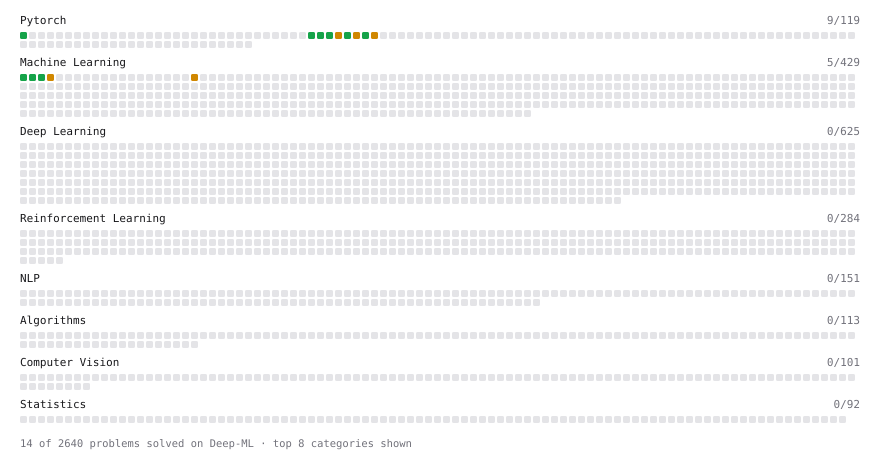

# Deep-ML

My machine learning practice from [Deep-ML](https://www.deep-ml.com). Every solution here was written by hand.

**4** solved · 3 problems · 1 labs · 0 math

[**Browse the interactive portfolio**](https://usernameTH.github.io/deep-ml/) to replay this filling in over time.

## Problems

| | Difficulty | Solved | |
| --- | --- | --- | --- |
| [Feature Scaling Implementation](https://www.deep-ml.com/problems/16) | easy | 2026-02-25 | [solution](problems/0016-feature-scaling-implementation) |
| [Linear Regression Using Gradient Descent](https://www.deep-ml.com/problems/15) | easy | 2026-02-25 | [solution](problems/0015-linear-regression-using-gradient-descent) |
| [Linear Regression Using Normal Equation](https://www.deep-ml.com/problems/14) | easy | 2026-02-24 | [solution](problems/0014-linear-regression-using-normal-equation) |

## Labs

| | Difficulty | Solved | |
| --- | --- | --- | --- |
| [Fit Linear Regression with Autograd](https://www.deep-ml.com/labs/9ff596ea-672e-4101-9ce4-0856c55b62c9) | medium | 2026-11-23 | [solution](labs/9ff596ea-672e-4101-9ce4-0856c55b62c9-fit-linear-regression-with-autograd) |

---

_This file is regenerated by Deep-ML on every push._
